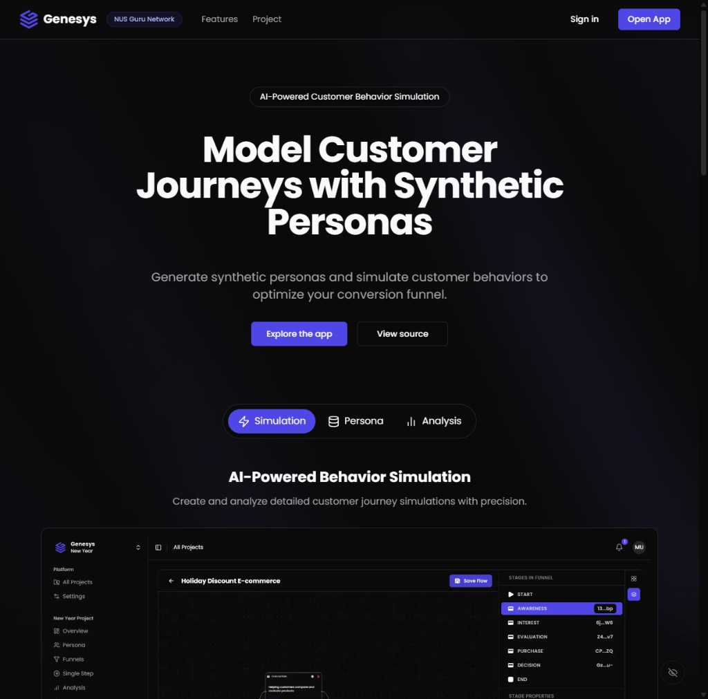

# Genesys

Genesys creates synthetic customer personas, runs them through branching marketing funnels, and
summarizes conversion and sentiment. It was developed for the NUS Guru Network AI Innovation
Project from January to May 2025.



Production: [genesys.utf.sh](https://genesys.utf.sh)

## Architecture

The application uses Next.js 16, React 19, TypeScript, Drizzle ORM, Tailwind CSS, and shadcn/ui.
Cloudflare Workers hosts the web application through OpenNext. Better Auth stores accounts and
sessions in Cloudflare D1. Cloudflare Queues runs simulations in a separate private Worker.
OpenAI GPT-5 nano generates personas, simulation responses, and summaries.

Validated server actions enforce project membership and owner roles. Registration requires an
invite code. Password changes require the current password. The October 2026 Cloudflare migration
starts with an empty database.

Cloudflare Workers, D1, and Queues use the Free plan. AI calls use the separately funded OpenAI
Genesys project, configured with a $5 monthly spending cap. Hosting does not include OpenAI usage.

## Local development

Use Node.js 24.15.x and pnpm 11.1.1.

```bash
corepack enable
pnpm install --frozen-lockfile
cp .env.example .env
```

Set three server-side values in `.env`. Never commit this file.

| Variable             | Purpose                                              |
| -------------------- | ---------------------------------------------------- |
| `OPENAI_API_KEY`     | Restricted OpenAI project key                        |
| `INVITE_CODE`        | Private registration code                            |
| `BETTER_AUTH_SECRET` | Random authentication secret, at least 32 characters |

Development scripts copy these values to ignored `.dev.vars` for the local Cloudflare runtime.
`APP_ORIGIN`, database bindings, and queue bindings live in the Wrangler configuration.
Optional analytics configuration is in [docs/ANALYTICS.md](docs/ANALYTICS.md).

```bash
pnpm db:migrate
pnpm dev
```

Open `http://localhost:3000`. Local D1 data is separate from production.

OpenNext does not guarantee full Windows build support. Use Linux CI for production packaging.
Standard Next.js development works on Windows. See the
[OpenNext Windows guidance](https://opennext.js.org/cloudflare#windows-support).

## Deployment

`wrangler.jsonc` configures the web Worker, D1 database, queue producer, and `genesys.utf.sh` custom
domain. `wrangler.simulations.jsonc` configures the private queue consumer. Both use the Free plan's
default CPU limits.

Authenticate Wrangler to the Cloudflare account. For a new account, create a D1 database named
`genesys` and a queue named `genesys-simulations`, then set the database ID in both Wrangler files.

```bash
pnpm db:migrate:remote
pnpm exec wrangler secret bulk .env
pnpm exec wrangler secret put OPENAI_API_KEY --config wrangler.simulations.jsonc
pnpm exec wrangler deploy --config wrangler.simulations.jsonc
```

The consumer needs only `OPENAI_API_KEY`. The web Worker needs all three secrets. These are runtime
bindings and are not required for CI builds.

CI checks formatting, lint, types, tests, dependency audit, and the Linux OpenNext build. Successful
runs provide a `cloudflare-build` artifact with one-day retention. To deploy it from Windows,
download the artifact and extract `cloudflare-build.tgz` into the matching checkout, then run:

```bash
pnpm exec opennextjs-cloudflare deploy
```

This deploys the extracted `.open-next` bundle without rebuilding. Apply database migrations and
queue-consumer changes separately. On Linux, `pnpm deploy` builds and deploys the web Worker.
Use `pnpm build:cloudflare` followed by `pnpm preview` to test the packaged application locally.

## Free-tier bounds

Workers Free permits 100,000 requests per day and 10 ms CPU per request. Network wait time does
not count as CPU time. Quotas can reject requests. Do not upgrade automatically.

Persona configurations support up to 25 personas. Funnels support 20 stages, 60 content items in
total, and 20 items per stage. Connections must form an acyclic graph with one starting stage.
Queue jobs process one persona at one stage, reuse saved decisions on redelivery, and retry
transient failures a bounded number of times. Use a small persona count while testing.

Provider limits: [Workers](https://developers.cloudflare.com/workers/platform/limits/),
[D1](https://developers.cloudflare.com/d1/platform/pricing/),
[Queues](https://developers.cloudflare.com/queues/platform/pricing/).

## Verification

```bash
pnpm check
pnpm audit:prod
pnpm build:cloudflare
```

Tests cover authorization, safe redirects, identifiers, password verification, and funnel graph
validation. Deployment checks should also cover registration, sign-in, project access, persona
generation, queue completion, and summary generation against a disposable project.

## Layout

```text
src/app/       Next.js routes and UI
src/db/        D1 client and Drizzle schemas
src/lib/       Authentication, AI, and runtime helpers
src/server/    Validated server actions and authorization
workers/       Queue consumer
migrations/    D1 migrations
scripts/       Local configuration helpers
```

Queue behavior is documented in [docs/custom-queue-system.md](docs/custom-queue-system.md).

## Contributions and security

Maintainers manage development. External contributions and pull requests are not accepted.
Report vulnerabilities through [GitHub private reporting](https://github.com/faqihxdev/genesys/security/advisories/new).
See the [security policy](SECURITY.md) and [repository maintenance guide](docs/repository-protection.md).

## License

[MIT](LICENSE).
