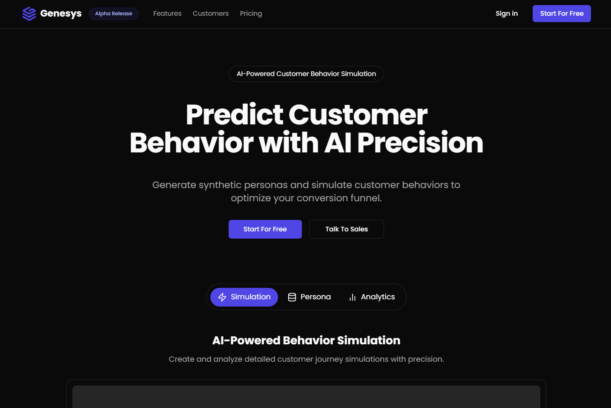

# 🌟 Genesys

A generative AI-powered platform that creates diverse synthetic customer personas to simulate unique behaviors through marketing funnels, revealing friction points and conversion triggers for global campaign optimization.

## 📸 Screenshot


_AI-Powered Customer Behavior Simulation Platform_

## 🚀 Features

- 🤖 AI-Powered Persona Generation
- 📊 Marketing Funnel Simulation
- 📈 Conversion Analysis
- 🎯 Friction Point Detection
- 🔄 Campaign Optimization
- 👥 Team Collaboration
- 📨 Notification System
- 🎫 Support System

## 🛠️ Tech Stack

- ⚛️ **Frontend Framework**: React 19 with NextJS 15
- 🔷 **Language**: TypeScript
- 🎨 **Styling**: Tailwind CSS + ShadcnUI
- 🔄 **State Management**: Jotai
- 🎯 **Form Handling**: React Hook Form
- ✨ **Icons**: Lucide React
- 🔍 **Data Fetching**: Tanstack Query
- 🗄️ **Database**: Supabase
- 🔒 **Authentication**: Supabase Auth
- 📦 **Package Manager**: pnpm
- 🚀 **Deployment**: Vercel
- ✅ **Validation**: Zod

## 📁 Project Structure

```
src/
├── app/             # Next.js app router pages
├── components/      # Reusable components
├── db/             # Database schemas and utilities
├── hooks/          # Custom React hooks
├── lib/            # Utilities and libraries
├── server/         # Server actions
├── stores/         # Jotai state management
├── middleware.ts   # Next.js middleware
├── env.js          # Environment variables
└── types.ts        # TypeScript definitions
```

## 🏗️ Architecture

### Database Schema

- Drizzle ORM with PostgreSQL
- Consistent ID generation with prefixes
- Timestamp tracking (created, updated, deleted)
- Strong typing with TypeScript
- Optimized indexing

### Server Actions

- Type-safe server functions
- Built-in Zod validation
- Comprehensive error handling
- Authentication middleware
- Clear separation of concerns

### API Patterns

- RESTful CRUD operations
- Server-side validation
- Type-safe query keys
- Error handling and logging
- Auth checks and middleware

## 🚦 Getting Started

1. **Prerequisites**

   ```bash
   node >= 18.0.0
   pnpm >= 8.0.0
   ```

2. **Installation**

   ```bash
   pnpm install
   ```

3. **Environment Setup**

   ```bash
   cp .env.example .env
   # Fill in your environment variables
   ```

4. **Database Setup**

   ```bash
   pnpm db:generate  # Generate migrations
   pnpm db:push     # Push to database
   ```

5. **Development**

   ```bash
   pnpm dev
   ```

6. **Build**
   ```bash
   pnpm build
   pnpm start
   ```

## 🧪 Development Guidelines

### Coding Standards

- Use JSDocs for functions and components
- Follow TypeScript best practices
- Implement proper error handling
- Write mobile-responsive components
- Support both light and dark themes

### Component Guidelines

- Use ShadcnUI when possible
- Implement proper loading states
- Handle all error cases
- Follow accessibility best practices
- Use React Hook Form for forms

### State Management

- Use Jotai for global state
- Keep state close to where it's used
- Implement proper loading states
- Handle error states
- Use proper TypeScript types

## 📖 Development Guide

### Server Actions Pattern

#### Using `createAction`

```typescript
// Example of a server action
export const createProject = createAction({
  // Zod validator for input
  validator: z.object({
    name: z.string().min(1, 'Name is required'),
    description: z.string().optional(),
  }),
  // Require authentication
  requireAuth: true,
  // Action implementation
  actionFn: async ({ input, currentUser }) => {
    // Implementation
  },
});
```

Key points:

- Always use Zod for input validation
- Specify authentication requirement
- Type-safe input and output
- Built-in error handling
- Automatic logging

#### Using `withQuery`

```typescript
// In your React component
const { data } = useQuery({
  queryKey: queryKey.projects.getProjectById({ projectId }),
  queryFn: () => withQuery(getProjectById)({ projectId }),
});
```

Key points:

- Wraps server actions for use with TanStack Query
- Handles error states automatically
- Provides type safety
- Consistent error handling
- Automatic data transformation

### Query Key Management

```typescript
// Type-safe query keys in query-keys.ts
export const queryKey = {
  projects: {
    getProjectById: ({ projectId }: { projectId: string }) =>
      ['projects', 'detail', projectId] as const,
    getCurrentUserProjects: () => ['projects', 'user'] as const,
  },
} as const;
```

Key points:

- Centralized query key management
- Type-safe key generation
- Consistent key structure
- Prevents key conflicts
- Easy refactoring

### Database Schema Pattern

```typescript
// Example schema definition
export const projects = pgTable(
  'projects',
  {
    id: text().$defaultFn(() => generateId({ length: ID_LENGTH, prefix: 'prj-' })),
    name: text().notNull(),
    description: text(),
    ...timestamps,
  },
  (table) => [index('project_name_idx').on(table.name)]
);

// Relations definition
export const projectsRelations = relations(projects, ({ many }) => ({
  users: many(projectUsers),
}));
```

Key points:

- Use consistent ID generation with prefixes
- Include standard timestamps
- Define proper indexes
- Use relations for type safety
- Export inferred types

### Error Handling Pattern

```typescript
try {
  // Implementation
} catch (error) {
  console.error('[ComponentName/functionName]:', error);
  throw new Error(error.message);
}
```

Key points:

- Consistent error logging format
- Context-aware error messages
- Type-safe error handling
- Proper error propagation
- Clear error boundaries

### State Management Pattern

```typescript
// Atom definition
export const userSettingsAtom = atom({
  key: 'userSettings',
  default: null as UserSettings | null,
});

// Derived state
export const userThemeAtom = atom((get) => {
  const settings = get(userSettingsAtom);
  return settings?.theme ?? 'system';
});
```

Key points:

- Use atoms for global state
- Derive state when possible
- Keep state minimal
- Type-safe state
- Clear state dependencies

### Form Handling Pattern

```typescript
// Form schema
const formSchema = z.object({
  name: z.string().min(1, 'Name is required'),
  email: z.string().email('Invalid email'),
});

// Form component
export const ProjectForm = () => {
  const form = useForm<z.infer<typeof formSchema>>({
    resolver: zodResolver(formSchema),
  });

  return (
    <Form {...form}>
      {/* Form fields */}
    </Form>
  );
};
```

Key points:

- Use Zod for form validation
- Type-safe form fields
- Consistent error messages
- Reusable form schemas
- Proper form state management

### Component Pattern

```typescript
interface ButtonProps extends React.ButtonHTMLAttributes<HTMLButtonElement> {
  variant?: 'default' | 'outline' | 'ghost';
  size?: 'sm' | 'md' | 'lg';
}

export const Button = React.forwardRef<HTMLButtonElement, ButtonProps>(
  ({ variant = 'default', size = 'md', ...props }, ref) => {
    return (
      <button
        ref={ref}
        className={cn(buttonVariants({ variant, size }))}
        {...props}
      />
    );
  }
);
Button.displayName = 'Button';
```

Key points:

- Proper TypeScript props
- Forward refs when needed
- Use proper display names
- Consistent styling pattern
- Accessibility support

## 🔒 Security

- Invite-only registration system
- Supabase authentication
- Role-based access control
- Secure environment variables
- Input validation and sanitization

## 🚀 Deployment

The application is deployed on Vercel with the following configuration:

- Automatic deployments from main branch
- Environment variable management
- Edge functions support
- Serverless functions
- Global CDN

## 🤝 Contributing

1. Fork the repository
2. Create your feature branch
3. Commit your changes
4. Push to the branch
5. Create a Pull Request

## 📝 License

This project is proprietary and confidential.

## 👥 Team

Made with ❤️ by Genesys Team
