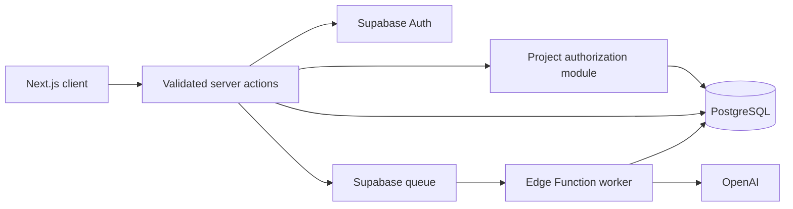

# Genesys

Genesys is a generative-AI system for creating synthetic customer personas, running them through
branching marketing funnels, and surfacing conversion friction and behavioral patterns. It was
developed for the NUS Guru Network AI Innovation Project from January to May 2025.


## Core capabilities

- Configurable synthetic persona generation with structured traits
- Visual branching-funnel authoring with React Flow
- Queue-backed, multi-persona simulation processing
- Stage and item-level summaries with conversion and sentiment analysis
- Multi-project collaboration with owner/member roles
- Supabase authentication, PostgreSQL persistence, and Drizzle ORM
- Accessible responsive UI, dark mode, and reusable shadcn/ui primitives

## Architecture



Security-sensitive mutations pass through a shared server-action wrapper for validation and session
checks, then through resource-level project authorization. Database access uses server-only
credentials; service-role credentials are never exposed to the browser.

## Stack

- Next.js 15 and React 19
- TypeScript
- Tailwind CSS and shadcn/ui
- TanStack Query, Jotai, React Hook Form, and Zod
- Drizzle ORM and PostgreSQL
- Supabase Auth and queue infrastructure
- OpenAI
- Vitest, ESLint, Prettier, and GitHub Actions

## Local setup

### Prerequisites

- Node.js 24.15 or newer (24.x)
- pnpm 11 (the repository pins the package-manager version)
- A Supabase project or compatible local PostgreSQL instance
- An OpenAI API key for persona generation and analysis

### Install

```bash
git clone https://github.com/faqihxdev/genesys.git
cd genesys
corepack enable
pnpm install
cp .env.example .env
```

Fill in `.env` with credentials from your own services. Never commit that file.

| Variable                        | Purpose                                    |
| ------------------------------- | ------------------------------------------ |
| `NEXT_PUBLIC_SUPABASE_URL`      | Supabase project URL                       |
| `NEXT_PUBLIC_SUPABASE_ANON_KEY` | Browser-safe Supabase anonymous key        |
| `SUPABASE_DATABASE_URL`         | PostgreSQL connection string               |
| `SUPABASE_SERVICE_ROLE_KEY`     | Server-only Supabase administration key    |
| `OPENAI_API_KEY`                | Server-side OpenAI access                  |
| `INVITE_CODE`                   | Private account-registration code          |
| `NEXT_PUBLIC_UMAMI_WEBSITE_ID`  | Optional Umami site identifier             |
| `NEXT_PUBLIC_UMAMI_DOMAINS`     | Optional comma-separated analytics domains |

### Database

The initial Drizzle migration is tracked in `supabase/migrations`.

```bash
pnpm db:migrate
```

Run migrations only against a database you control. `pnpm db:generate` creates a migration from
schema changes; `pnpm db:push` is intended for deliberate development use.

### Run

```bash
pnpm dev
```

Open `http://localhost:3000`. Simulation processing uses the queue and Edge Function described in
`docs/custom-queue-system.md`.

## Verification

```bash
pnpm format:check
pnpm lint
pnpm typecheck
pnpm test:coverage
pnpm audit --prod --audit-level high
pnpm build
```

GitHub Actions runs the same checks in a read-only, least-privilege workflow.

## Project structure

```text
src/
├── app/          # Next.js App Router routes
├── components/   # Shared UI and funnel-builder modules
├── db/           # Drizzle client and schemas
├── hooks/        # Reusable React hooks
├── lib/          # Server/client adapters and utilities
├── server/       # Validated server actions and authorization
└── stores/       # Jotai state

supabase/
├── functions/    # Queue-processing Edge Function
└── migrations/   # Reproducible database schema
```

Additional design notes are available in `docs/`.

## Security notes

- Server actions validate inputs with Zod.
- Project-backed resources require authenticated membership.
- Owner-only operations enforce the project role on the server.
- Authentication redirects are restricted to same-origin paths.
- Database TLS certificate verification remains enabled in production.
- Optional analytics identifiers are environment-configured.

If you find a vulnerability, avoid including credentials or personal data in a public issue. Contact
the repository owner privately through their GitHub profile.

## Contributions

Development is managed by the project maintainers. External contributions and pull requests are not
accepted.

## License

Released under the [MIT License](LICENSE).
