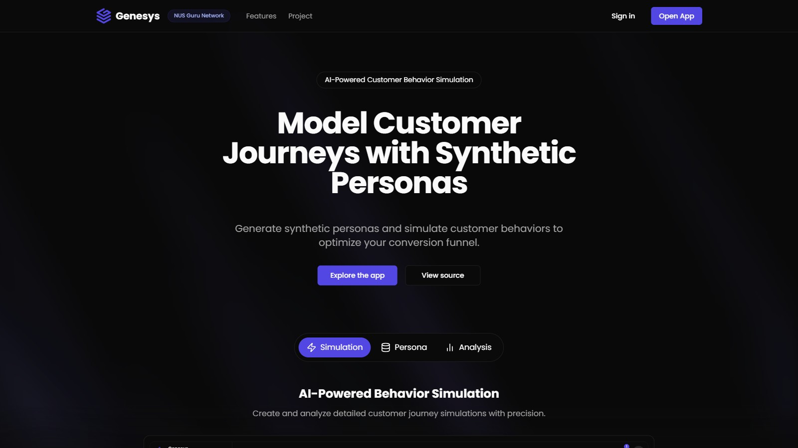
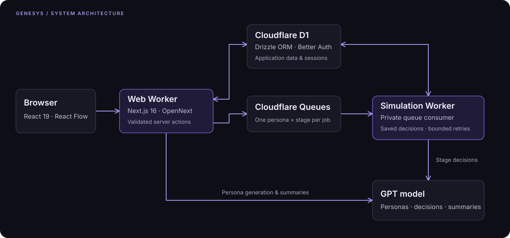

# Genesys

Generate synthetic customer personas, run them through branching marketing funnels, and analyze
AI-generated reactions, conversion, and sentiment.

[Live app](https://genesys.utf.sh) · [CI](https://github.com/faqihxdev/genesys/actions/workflows/ci.yml) · [Development & deployment](docs/development.md)

[](https://genesys.utf.sh)

## Architecture

Next.js 16, React 19, and TypeScript, with Tailwind CSS and shadcn/ui. OpenNext runs the application
on Cloudflare Workers. Drizzle maps application data and Better Auth sessions to D1.



## Engineering highlights

| Capability           | Implementation                                                                                                                                              |
| -------------------- | ----------------------------------------------------------------------------------------------------------------------------------------------------------- |
| Visual funnel design | React Flow editor with branching stages, content items, and validation for cycles and a single entry point.                                                 |
| Structured AI        | Configurable persona traits, batched generation, schema-constrained stage decisions, and validation of item coverage and allowed next stages.               |
| Queue recovery       | One persona per stage per job. D1 batches persist decisions and responses together; redelivery reuses saved decisions. Retries and concurrency are bounded. |
| Project isolation    | Better Auth sessions, invite-gated registration, and server-side membership and owner-role checks.                                                          |
| Analysis             | Conversion, drop-off, and sentiment views, plus AI-generated summaries and recommendations at simulation, stage, and content level.                         |
| Verification         | Linux CI checks formatting, lint, types, tests with coverage, production dependencies, and the Cloudflare build. CodeQL scans TypeScript and Actions.       |

See [queue processing](docs/custom-queue-system.md) for delivery and recovery details.

## Run locally

Use Node.js 24.15.x and pnpm 11.1.1.

```bash
corepack enable
pnpm install --frozen-lockfile
cp .env.example .env
```

Set `OPENAI_API_KEY`, `INVITE_CODE`, and a random `BETTER_AUTH_SECRET` of at least 32 characters
in `.env`, then start the app:

```bash
pnpm db:migrate
pnpm dev
```

Open `http://localhost:3000`. See the [development guide](docs/development.md) for verification,
Cloudflare deployment, and Windows build guidance.

## Project

Developed for the NUS Guru Network AI Innovation Project, January to May 2025.
Hosted on Cloudflare's Free plan; OpenAI usage is billed separately. App registration requires
an invite code.

Maintainers manage development. External contributions and pull requests are not accepted.
[Report vulnerabilities privately](https://github.com/faqihxdev/genesys/security/advisories/new).
[Security policy](SECURITY.md) · [Repository maintenance](docs/repository-protection.md) · [MIT license](LICENSE)
